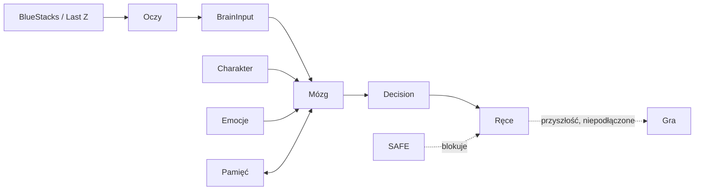
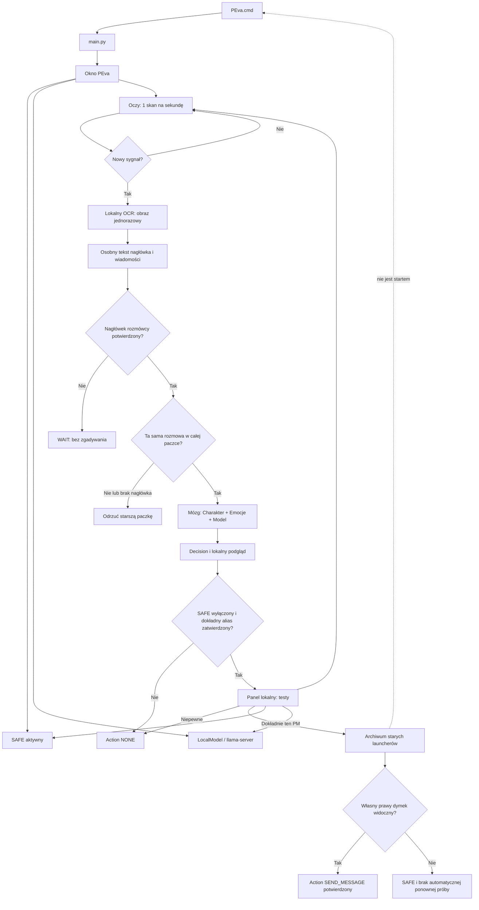
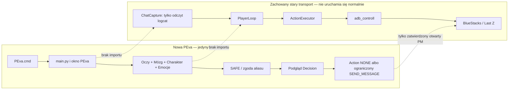
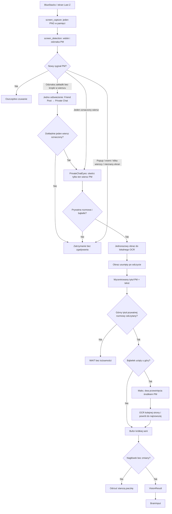
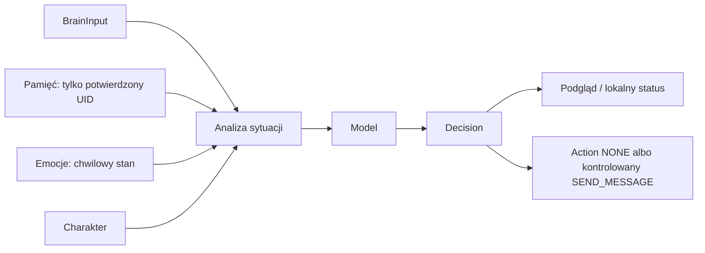
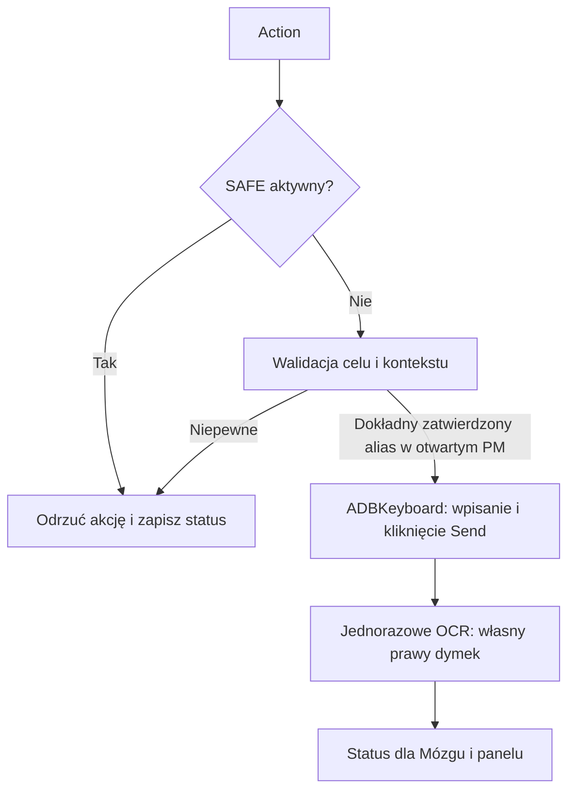

# PEva — architektura docelowa

To są małe diagramy, a nie jeden wielki rysunek. Każdy moduł zna tylko dane,
które dostaje i przekazuje dalej.

## Docelowy przepływ (jeszcze nieaktywny)

Ten rysunek pokazuje kierunek rozwoju. Strzałka z Rąk do gry **nie istnieje**
w obecnej wersji PEva i nie może zostać włączona zwykłym startem.



## Faktycznie zbudowany rdzeń (ograniczona, zatwierdzana odpowiedź PM)



Nagłówek nie daje UID. Może wskazać cel automatycznej odpowiedzi tylko wtedy,
gdy odpowiada dokładnie ręcznie ustawionemu aliasowi znajomego, którego użytkownik
osobno zatwierdził w lokalnym panelu. Oczy mogą co najwyżej otworzyć jeden, wizualnie jednoznaczny
wiersz PM albo wykonać ograniczone przewinięcie środkiem potwierdzonego PM,
aby go przeczytać; nie znają wpisywania ani wysyłania tekstu. Wpisywanie należy
do osobnego adaptera Rąk i następuje dopiero po ponownej, jednorazowej kontroli
nagłówka. Brak własnego dymka po tapnięciu Send oznacza SAFE i brak retry.

## Granica nowej PEva i zachowanego starego transportu



`ChatCapture` przyjmuje obecny callback `push.chat.up.room` i historyczny
`push.chat.room`, lecz nadal znajduje się po stronie zachowanego transportu.
Nie jest częścią startu przez `PEva.cmd`. Stara ścieżka pozostaje wyłącznie do
audytu i zgodności, dopóki jej elementy nie będą osobno bezpiecznie wydzielone.

## Oczy



Helper bierze tożsamość rozmowy wyłącznie z krótkiego, wycentrowanego tytułu
u góry otwartego PM. Linie nad dymkami (`V8`, `LV.27`, płeć, sojusz i nick)
opisują autora pojedynczej wiadomości i nie zastępują tego tytułu. Gdy tytuł
nie jest czytelny, PEva czeka bez odpowiedzi.

Pamięć może zostać dołączona do `BrainInput` dopiero przez przyszły resolver,
który ma niezależnie potwierdzony UID rozmówcy. Sama nazwa z nagłówka OCR nie
jest kluczem do bazy pamięci.

Odświeżenie zakładek jest dostępne wyłącznie, gdy lista **Prywatny czat** jest
już widoczna i przez 45 sekund nie ma nowego sygnału, albo natychmiast po
zaobserwowaniu czerwonej odznaki bez oznaczonego wiersza. PEva nie ma dostępu
do wiarygodnego systemowego sygnału dotknięcia użytkownika, dlatego nie udaje,
że zna jego aktywność; nie opuszcza też samodzielnie otwartej rozmowy.

## Mózg



## Ręce



## Proste kontrakty między modułami

```python
VisionResult(screen="PRIVATE_CONVERSATION", message="...", confidence=0.97)
BrainInput(vision=vision_result, memory=..., emotion=..., personality=...)
Decision(kind="REPLY", reason="new_private_message", text="...")
Action(kind="SEND_MESSAGE", target="verified_private_chat", text="...")
```

Sposób zdobycia tekstu — OCR, późniejszy parser UI lub inna metoda — pozostaje
wewnętrznym szczegółem Oczu. `BrainContextBuilder` tworzy z tego `BrainInput`,
który dopiero później trafi do modelu.
