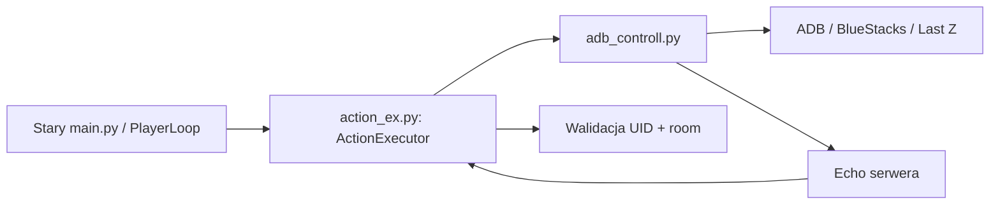

# PEva — audyt Rąk przed migracją

Ten dokument oddziela kod, który **może wykonać ruch w grze**, od nowego
bezpiecznego rdzenia. Jest to warunek przed podłączeniem jakiegokolwiek
generowanego tekstu do Last Z.

## Gdzie są obecne Ręce

| Plik | Rola | Stan przy przebudowie |
|---|---|---|
| `adb_controll.py` | Niskopoziomowe ADB: odczyt ekranu/logcat, tap, swipe, wpisywanie, nawigacja PM, echo serwera. | Właściwy kod jest w `archive/legacy_runtime/`; nazwa główna wskazuje ten sam moduł wyłącznie dla zgodności. Nowe Oczy i Ręce używają własnych, wąskich adapterów bez API tekstu. |
| `action_ex.py` | Waliduje akcje; dla PM wymaga `target_uid` i poprawnego `room_id`. | Właściwy kod jest w `archive/legacy_runtime/`; nazwa główna jest mostkiem zachowanego transportu. |
| `navigation_manager.py` | Plan przejścia po ekranach w starym PlayerLoop. | Właściwy kod jest w `archive/legacy_runtime/`; nazwa główna jest tylko mostkiem zgodności. |
| `player_loop.py` | Duży dawny koordynator Agency, pamięci, akcji i odzyskiwania błędów. | Właściwy kod jest w `archive/legacy_runtime/`; nie jest zależnością nowego `peva_runtime.py`. |
| `coordinates.py` | Stałe ekranowe dla starego transportu ADB. | Właściwy plik jest w `archive/legacy_runtime/`; nazwa główna jest tylko mostkiem zgodności. |

## Dokładna granica odczytu Oczu

`oczy/android_capture.py` jest jedynym miejscem Oczu, które prosi ADB o
obraz. Jego kontrakt jest celowo wąski: wykonuje wyłącznie jedno polecenie
`exec-out screencap -p`, trzyma PNG wyłącznie w pamięci i zwraca obraz do
analizy. Nie zapisuje zrzutu, nie uruchamia pętli, nie dotyka interfejsu i nie
zna żadnego API tekstowego.

`rece/read_only_navigation.py` korzysta z dwóch ograniczonych gestów przez
`rece/read_only_adb.py`:
otwiera środek wykrytego wiersza PM albo przewija środek już otwartego PM.
Współrzędne są obliczane wewnątrz modułu; moduł nie przyjmuje dowolnego ruchu
od modelu i nie zawiera wpisywania ani wysyłania.

Automatyczne testy sprawdzają dokładne argumenty odczytu PNG, zgodność starego
wejścia `oczy.vision.capture_frame` oraz brak symboli tekstu/wysyłania w
ograniczonych Rękach. `adb_controll.py` nie jest częścią nowego runtime;
pozostaje wyłącznie zachowanym transportem dla zgodności i audytu.

## Co chroni stary transport

Ścieżka `reply_private` w `ActionExecutor` już ma ważne zabezpieczenia:

1. wymaga pełnego `reply_id`, `target_uid`, `room_id` oraz tekstu;
2. sprawdza, czy room jest dokładnie bezpośrednim PM PEva + wskazany UID;
3. przed wpisaniem tekstu wymaga potwierdzonego otwartego celu;
4. uznaje wysłanie dopiero po pasującym echo serwera;
5. po niepewnym wyniku nie wykonuje automatycznej ponownej próby.

To są wartościowe reguły, więc nie będziemy ich przepisywać w ciemno.

## Dlaczego nowy runtime ich nie używa

`peva_runtime.py` ma obecnie tylko tekst z Oczu i ewentualnie nazwę z nagłówka
PM. Nazwa **nie jest UID**, a zatem nie spełnia warunku starego transportu.
Połączenie go teraz byłoby ryzykiem błędnego odbiorcy. Z tego powodu nowy
runtime kończy każdą decyzję `Action(NONE)`, nawet gdy model stworzy poprawny
podgląd odpowiedzi.

Globalny `SafetyGate` istnieje już w `rece/safety.py`, ale stare `main.py`
jeszcze go nie używa. W aktywnym `config/settings.json` auto-send jest obecnie
ustawiony na `false`; mimo to nie traktujemy tego jako wystarczającego dowodu
na bezpieczeństwo nowego projektu.

## Plan bezpiecznej migracji

1. **Resolver tożsamości:** pobrać nagłówek tylko do podglądu; UID musi
   pochodzić z niezależnego, zweryfikowanego źródła, nie z nazwy ani pamięci.
2. **Adapter Rąk:** stworzyć mały moduł w `rece/`, który przyjmuje wyłącznie
   kompletne `target_uid` + `room_id` + tekst i pyta `SafetyGate` przed
   wezwaniem starego, sprawdzonego transportu.
3. **Testy sztuczne:** zablokowany SAFE, zły UID, zmieniony nick, zły room,
   popup, brak echo i niejednoznaczna dostawa. Żaden z nich nie może dotknąć
   rzeczywistego Send.
4. **Test ręczny:** dopiero po zaakceptowaniu podglądu przez użytkownika i z
   osobnym kontem testowym.
5. **Dopiero później:** decyzja, czy w ogóle umożliwić ręczne wysłanie. Auto
   send nie jest częścią tej fazy.

## Wniosek

Nie podłączamy `adb_controll.py`, zachowanego `ActionExecutor` ani
zachowanego `PlayerLoop` do nowego runtime. To nie jest bałagan do
automatycznego posprzątania: zawierają jeszcze aktywny mechanizm fizyczny.
Właściwy kod całego starego łańcucha jest już archiwizowany, ale zachowuje
pełną zgodność dla starszych narzędzi. Najpierw nowa PEva musi mieć pewny UID rozmówcy i
testowalny adapter SAFE; dopiero potem można skracać stary runtime bez utraty
zabezpieczeń.

## Wynik audytu źródeł po przebudowie

Potwierdzona stara ścieżka wykonawcza brzmi:

`PlayerLoop → ActionExecutor → adb_controll → ADB / BlueStacks / Last Z`.

Zwykły start (`main.py`, okno, panel), Mózg, Charakter i Emocje nie importują
żadnego jej elementu ani `trening/`. Ta granica jest automatycznie sprawdzana
w `testy/test_new_runtime_boundaries.py`. Oczy i Ręce odczytu nie importują
też starego ADB ani nie mają API wpisywania lub wysyłania.
